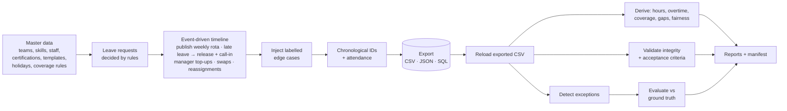

# FairShift — fair, feasible shift scheduling with traceable exceptions

FairShift combines **leave requests, shift coverage, skills and labour constraints** into schedules that are
feasible (hard rules never broken), fair (load spread evenly) and traceable (every change is an event, every
decision has a rule-based reason). It generates a realistic synthetic workforce at the volume in the brief,
runs a schedule over 90 days of operations, injects the five required edge cases as **labelled** anomalies,
and then proves — from the exported files alone — that the data is consistent and that every anomaly is caught.

- **Standard library only** (Python ≥ 3.10). No database server, no network, no API keys.
- **Full brief volume in ~30 s**: 2,000 employees · 100 teams · 90 days · 5,000 leave requests.
- **Byte-for-byte reproducible** from a fixed seed (`20261022`), verified across separate processes.

## Quick start

```bash
git clone <this-repo> && cd fairshift-scheduler
python -m fairshift generate --scale starter      # ~1 s  -> out/starter/
python -m fairshift generate --scale full         # ~30 s -> out/full/  (brief's volume, ~200 MB)
python -m unittest -v                             # 27 tests, ~3 s
python -m fairshift repro --scale starter         # generate twice, compare SHA-256 of every file
python -m fairshift validate --data out/starter   # re-validate a folder from its files (e.g. after hand edits)
```

Open `out/<scale>/reports/report.html` in a browser for the visual report. No install step is needed; optionally
`pip install -e .` adds a `fairshift` command. `make starter|full|test|repro|docs` wrap the same commands.

A pre-generated starter dataset is committed in [`sample_output/starter/`](sample_output/starter/) so reviewers can
inspect outputs without running anything. The full dataset is not committed (size); regenerate it with the command above.

## Results (full scale, seed 20261022)

| Measure | Result |
|---|---|
| Validation checks on exported files (keys, FKs, enums, dates, arithmetic, lifecycles, duplicates, acceptance criteria, SQLite load with FKs enforced) | **144 / 144 pass** |
| Exception detector vs ground truth (100 labelled anomalies, 20 per type) | **precision 1.000, recall 1.000** |
| Hard-constraint guard rules (rest, consecutive days, night eligibility, employment dates, managers off rota) | **0 violations** |
| Coverage requirements met — at publication / final schedule / attended | 99.8% / 99.2% / 97.6% of 92,960 team-shift requirements |
| Coverage gaps reported, by stage | 71 planning · 698 post-publication · 1,495 attendance (all explained in `coverage_gaps.csv`) |
| Fairness — mean within-team Gini of utilisation | 0.027 (worst team 0.073; 0 = perfectly even) |
| Overtime | 5,848 h scheduled (always ≤ cap) · 12,704 h actual from late clock-outs · 20 employee-weeks over cap, all labelled |
| Leave decisions (5,000) | 3,853 approved · 847 rejected · 169 cancelled · 131 expired, each with a rule-based reason |
| Swaps (1,515) | 761 applied · 664 rejected (13 distinct reasons) · 72 withdrawn · 18 pending |
| Reproducibility | identical SHA-256 for every file across two processes with different `PYTHONHASHSEED` |

Full details: [`docs/VERIFICATION.md`](docs/VERIFICATION.md).

## How the brief maps to this repository

| Brief requirement | Where it is met |
|---|---|
| Entities: Employee, Team, Skill, ShiftTemplate, ShiftAssignment, LeaveRequest, HolidayCalendar, AttendanceEvent, CoverageRequirement, SwapRequest | `fairshift/schema.py` (15 tables incl. bridge + event logs); [`docs/DATA_DICTIONARY.md`](docs/DATA_DICTIONARY.md), [`docs/ERD.md`](docs/ERD.md) |
| PK for every entity, FK for every relationship, cardinality, optional relationships, effective dates, lifecycle states, bridge tables | Schema + generated ERD; `employee_skill` bridge (N:M, effective-dated); state machines for assignments, leave, swaps |
| Step 1 — data dictionary (type, required, allowed values, units, uniqueness, validation rule) | Generated from the schema: `python -m fairshift docs` |
| Step 2 — parents first; teams, skills, templates, min staffing per shift & skill, leave + approvals, attendance, assignment, swaps with manager approval, overtime and gaps | `master.py` → `leave.py` → `simulate.py` → `attendance.py` → `derive.py` |
| Step 3 — ID conventions `EMP-000001`, `SHIFT-2026-01-01-A`, `LVE-2026-000001`, `ATT-<employee-id>-<timestamp>`, `SWP-2026-000001` | `core.py`; enforced by regex in the validator and unit tests |
| Step 4 — 2,000 employees, 100 teams, 90 days, 5,000 leaves, holidays, absences, overtime caps, skill-specific staffing; fixed seed; one parameterised generator | `config.py` (`starter`/`full` presets + CLI overrides) |
| Step 5 — valid baseline first, then labelled edge cases (double-booked, leave overlap, skill absent, overtime cap, swap without approval) | `anomalies.py` — each injection breaks exactly one rule |
| Step 6 — derived values from source records | `derive.py`, computed from the *exported CSVs* |
| Step 7 — separate ground truth, no leakage | `ground_truth/` outside `data/`; IDs assigned chronologically after injection so position doesn't leak |
| Step 8 — PK, FK, enums, date ordering, arithmetic, lifecycles, duplicates | `validate.py` → `reports/validation_summary.md` |
| Step 9 — CSV/JSON/SQL, README, dictionary, command, seed, source manifest, validation summary | `data/{csv,json,sql}`, `manifest/run_manifest.json` (command, seed, config, checksums), `manifest/source_manifest.json` |
| Step 10 — regenerate twice, compare counts/checksums | `python -m fairshift repro` → `sample_output/starter/reports/reproducibility_report.md` |
| Acceptance: coverage met or gaps reported; working-hour constraints hold; attendance reconciles; swap history preserved | Validator checks AC1–AC4; `derived/coverage_gaps.csv`, `weekly_hours.csv`, `attendance_reconciliation.csv` |
| Expose key decisions and exceptions; traceability; measurable outputs | `decision_reason` on every leave/swap; `assignment_event` history; `derived/exceptions.csv`; `reports/evaluation.json` |

## How it works



The organisation modelled is a multi-site warehouse and support operation in five Indian regions, running three
8-hour shifts (Early 06–14, Late 14–22, Night 22–06). Key rules:

- **Hard constraints** (never broken by the scheduler, independently re-checked): one shift per day, ≥ 11 h rest,
  ≤ 6 consecutive days, weekly hours ≤ cap (40/48 h full-time, 24/32 h part-time), night shifts only for eligible staff,
  no work on approved leave or outside employment dates, skill slots only for **valid, unexpired** holders.
- **Fairness**: among eligible people, pick the lowest load score (weekly utilisation, cumulative hours, then
  night/weekend/holiday burden). Overtime is used only when no one fits within contracted hours.
- **Leave** is decided by eight ordered rules (notice, balance, allowance, team concurrency cap, …); **swaps** by
  the same hard constraints plus "must not break a skill requirement that is currently met".

Design rationale and trade-offs: [`docs/DESIGN.md`](docs/DESIGN.md). Assumptions and limitations:
[`docs/ASSUMPTIONS_AND_LIMITATIONS.md`](docs/ASSUMPTIONS_AND_LIMITATIONS.md).

## Repository layout

```
fairshift/            package (standard library only)
  config.py           scale presets + every policy number in one place
  schema.py           single source of truth: tables, keys, enums, lifecycles
  core.py             deterministic RNG streams, ID formats, calendar helpers
  master.py           teams, skills, employees, certifications, templates, holidays, shifts, coverage rules
  leave.py            leave generation + rule-based decisions
  engine.py           schedule state, hard-constraint checks, fairness-ranked filling
  simulate.py         event-driven operations timeline (publish, leave, top-ups, swaps, reassignments)
  anomalies.py        labelled edge-case injection + ground truth
  attendance.py       clock events from the final schedule
  derive.py           derived values from exported files
  detect.py           independent rule-based exception detector + evaluation
  validate.py         integrity + acceptance checks, SQLite round trip
  io.py · report.py · docgen.py · pipeline.py · cli.py
tests/                27 unit, end-to-end and negative tests
docs/                 data dictionary, ERD (generated), design, assumptions, verification
sample_output/starter committed example outputs (data, derived, ground truth, reports, manifest)
ai/                   prompt history and AI-usage disclosure
```

Each output folder contains `data/` (inputs: csv, json, sql), `ground_truth/` (labels — kept apart),
`derived/` (computed results and exceptions), `reports/` (validation, evaluation, summary, HTML) and
`manifest/` (command, seed, config, row counts, SHA-256 of every file, data provenance).

## Limitations (summary)

Greedy, fairness-ranked scheduling rather than a global optimiser; a simplified single-timezone, fixed-shift model;
synthetic data only. See [`docs/ASSUMPTIONS_AND_LIMITATIONS.md`](docs/ASSUMPTIONS_AND_LIMITATIONS.md) for the full list
and next steps.

## AI usage

This project was built with substantial help from an AI assistant. Prompts and an account of what was reviewed and
validated by hand are in [`ai/`](ai/).
