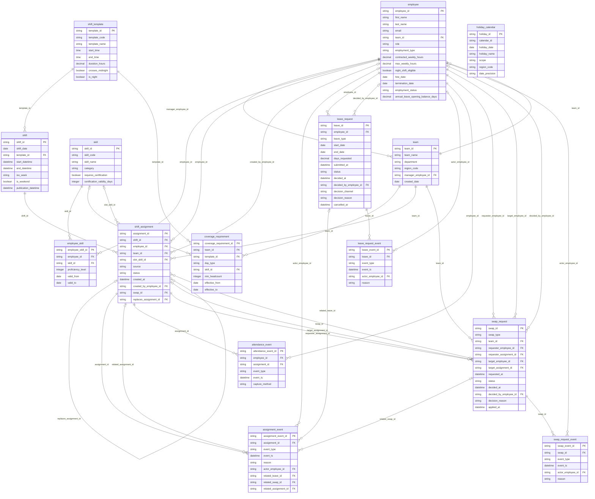

# Entity-relationship diagram

Generated from `fairshift/schema.py`. Every relationship is 1:N from parent to child;
`employee_skill` is the bridge table that resolves the N:M between `employee` and `skill`.

## Relationship list

| Parent | Child | Foreign key | Cardinality | Optional |
|---|---|---|---|---|
| employee | team | `manager_employee_id` | 1:N | no |
| team | employee | `team_id` | 1:N | no |
| employee | employee_skill | `employee_id` | 1:N | no |
| skill | employee_skill | `skill_id` | 1:N | no |
| shift_template | shift | `template_id` | 1:N | no |
| team | coverage_requirement | `team_id` | 1:N | no |
| shift_template | coverage_requirement | `template_id` | 1:N | no |
| skill | coverage_requirement | `skill_id` | 1:N | yes |
| shift | shift_assignment | `shift_id` | 1:N | no |
| employee | shift_assignment | `employee_id` | 1:N | no |
| team | shift_assignment | `team_id` | 1:N | no |
| skill | shift_assignment | `slot_skill_id` | 1:N | yes |
| employee | shift_assignment | `created_by_employee_id` | 1:N | yes |
| swap_request | shift_assignment | `swap_id` | 1:N | yes |
| shift_assignment | shift_assignment | `replaces_assignment_id` | 1:N | yes |
| shift_assignment | assignment_event | `assignment_id` | 1:N | no |
| employee | assignment_event | `actor_employee_id` | 1:N | yes |
| leave_request | assignment_event | `related_leave_id` | 1:N | yes |
| swap_request | assignment_event | `related_swap_id` | 1:N | yes |
| shift_assignment | assignment_event | `related_assignment_id` | 1:N | yes |
| employee | leave_request | `employee_id` | 1:N | no |
| employee | leave_request | `decided_by_employee_id` | 1:N | yes |
| leave_request | leave_request_event | `leave_id` | 1:N | no |
| employee | leave_request_event | `actor_employee_id` | 1:N | yes |
| employee | attendance_event | `employee_id` | 1:N | no |
| shift_assignment | attendance_event | `assignment_id` | 1:N | no |
| team | swap_request | `team_id` | 1:N | no |
| employee | swap_request | `requester_employee_id` | 1:N | no |
| shift_assignment | swap_request | `requester_assignment_id` | 1:N | no |
| employee | swap_request | `target_employee_id` | 1:N | no |
| shift_assignment | swap_request | `target_assignment_id` | 1:N | yes |
| employee | swap_request | `decided_by_employee_id` | 1:N | yes |
| swap_request | swap_request_event | `swap_id` | 1:N | no |
| employee | swap_request_event | `actor_employee_id` | 1:N | yes |

Many-to-many: `employee` N:M `skill` through `employee_skill` (effective-dated rows; a renewed certification is a new row).

Circular references (`team.manager_employee_id` ↔ `employee.team_id`, `shift_assignment.swap_id` ↔ `swap_request.requester_assignment_id`) are why all FKs are declared `DEFERRABLE INITIALLY DEFERRED`.
